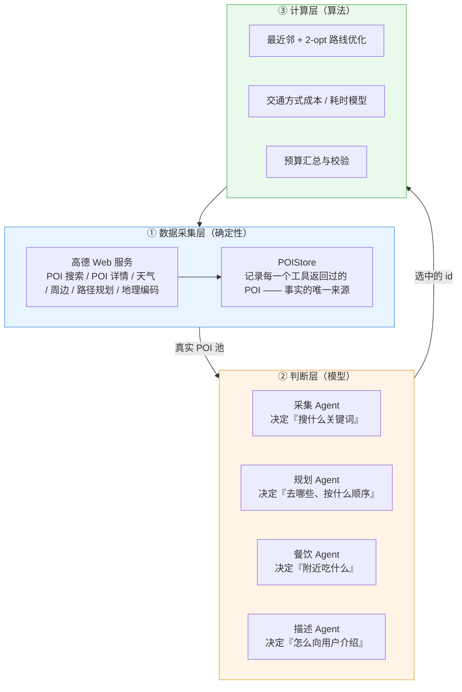
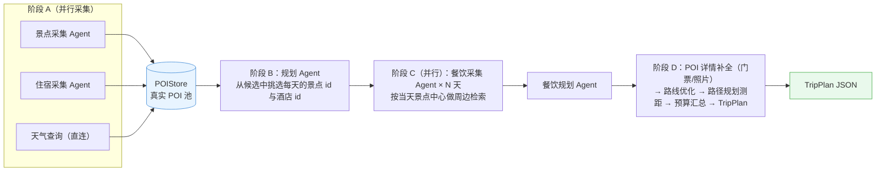
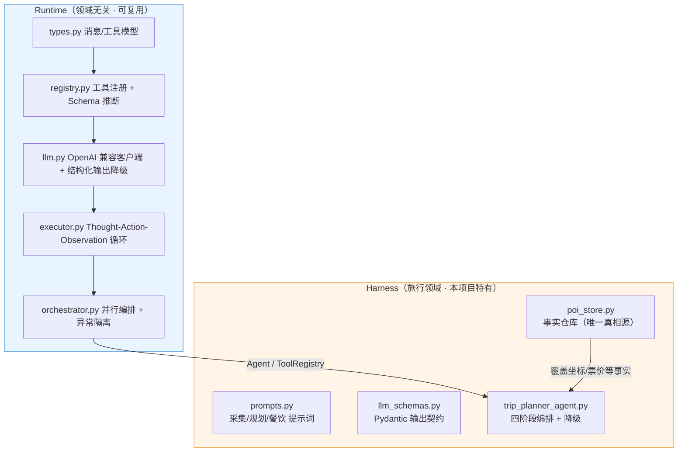

<div align="center">

# Trip Plan Agent 🌍✈️

**一个不依赖任何 Agent 框架的智能旅行规划系统**

Vue3 + TypeScript 前端 · FastAPI 后端 · 自研 Agent Runtime（function calling + 工具调度 + 并行编排）

[](https://www.python.org/)
[](https://fastapi.tiangolo.com/)
[](https://vuejs.org/)
[](https://www.typescriptlang.org/)
[](backend/tests)
[](LICENSE)

</div>

---

## 📑 目录

- [✨ 核心特性](#-核心特性)
- [🧠 设计理念](#-设计理念事实与判断分离)
- [🏗️ 架构与流水线](#️-架构与流水线)
- [🧰 Harness：运行时之上的领域层](#-harness运行时之上的领域层)
- [📂 项目结构](#-项目结构)
- [🚀 快速开始](#-快速开始)
- [⚙️ 配置项](#️-配置项)
- [🔌 API](#-api)
- [🧪 测试](#-测试)
- [🔀 双后端：REST 直连 / MCP](#-双后端rest-直连--mcp)
- [⚠️ 已知限制](#️-已知限制)
- [🗺️ Roadmap](#️-roadmap)
- [🤝 贡献指南](#-贡献指南)
- [📄 License](#-license)

---

## ✨ 核心特性

| 能力 | 说明 |
| --- | --- |
| 🧩 **自研 Agent 运行时** | `app/agent/` 下实现消息模型、工具注册表、JSON Schema 自动推断、Thought-Action-Observation 循环、并行编排、结构化输出降级，约 500 行可读代码 |
| 🧰 **领域 Harness 分层** | `app/agents/` 只放提示词、输出契约、事实校验与业务编排；运行时与领域逻辑彻底解耦，换领域可直接复用运行时 |
| 🔌 **标准 function calling** | 工具参数由模型以结构化形式给出，不再用提示词硬凑 `[TOOL_CALL:...]` 文本格式再解析 |
| 📍 **事实性数据保证** | 经纬度 / 地址 / 票价 / 评分 / 距离全部来自高德 API；模型只负责"选哪个、怎么描述"，编造的 POI 会被 `POIStore` 直接丢弃 |
| 🧮 **确定性路线优化** | 最近邻 + 2-opt 算法安排每日游览顺序，以酒店为起点，结果可复现、可解释 |
| 💰 **自洽预算** | 门票来自 POI 详情、餐饮来自真实餐厅、交通由路径规划接口 + 交通模型推算；各项之和恒等于总额 |
| ⚡ **并行编排** | 景点 / 住宿 / 天气三路并发采集，每日餐厅按天并发检索；单点失败自动降级，不影响整体 |
| 🧱 **双后端可切换** | 默认直连高德 Web 服务（零外部进程），也可用官方 MCP SDK 连接 `amap-mcp-server`，连接失败自动回落 |
| 🪶 **无框架依赖** | 不引入 LangChain / LlamaIndex / HelloAgents，只依赖 `openai` + `httpx` |
| 🧪 **可离线测试** | 32 个 pytest 用例，用假 LLM / 假高德跑通完整流水线，无需网络与 API Key |

---

## 🧠 设计理念：事实与判断分离

本项目把职责拆成三层，模型只在中间那层工作：



> 模型如果提到一个 `POIStore` 里不存在的地点，该条目会被**直接丢弃**，不允许进入最终行程。

---

## 🏗️ 架构与流水线



四个阶段均可独立降级：LLM 不可用时自动退化为确定性排程，只使用真实 POI，不会编造坐标。

---

## 🧰 Harness：运行时之上的领域层

本项目刻意分成两层：**Runtime（运行时）** 只关心"模型怎么思考、工具怎么调"，**Harness（领域外壳）** 只关心"旅行规划这件事怎么做对"。两者互不污染，Runtime 可以原样搬到别的领域，Harness 换掉不影响运行时。

| | Runtime（`app/agent/`） | Harness（`app/agents/`） |
| --- | --- | --- |
| 职责 | 消息模型、工具注册、function calling、结构化输出降级、并行编排 | 提示词、输出契约、事实校验、业务编排与降级 |
| 是否知道"旅行" | ❌ 完全领域无关 | ✅ 行程、景点、餐厅、预算 |
| 复用性 | 换个领域可直接用 | 与旅行领域强绑定 |
| 关键文件 | `types.py` `registry.py` `llm.py` `executor.py` `orchestrator.py` | `prompts.py` `llm_schemas.py` `poi_store.py` `trip_planner_agent.py` |



### Harness 的四块拼装

1. **提示词库（`prompts.py`）** — 每个子 Agent 一段系统提示词，规定角色、可用工具、输出格式与"不得编造"的硬约束。
2. **输出契约（`llm_schemas.py`）** — 用 Pydantic 定义模型**允许**产出什么。契约里只有 `id` 和描述性文字，**没有坐标字段的自由发挥空间**：

   ```python
   class DaySelection(BaseModel):
       day_index: int
       description: str
       attraction_ids: List[str]   # 只能给 id，不能自己编 POI
       hotel_id: Optional[str]
       notes: str
   ```

3. **事实仓库（`poi_store.py`）** — 记录工具返回过的每一个 POI（id → 高德原始数据 + 名称索引）。Harness 在把模型输出落地前，必须回到仓库核对：`id` 不存在 → 直接丢弃；`id` 存在 → 用仓库里的坐标、地址、票价**覆盖**模型的值。
4. **编排与降级（`trip_planner_agent.py`）** — 决定谁先谁后、谁并行、失败怎么办。四个阶段各有确定性兜底：LLM 不可用时退化为"按关键词直接搜、按天数均匀分配"，依然只使用真实 POI。

### 在本运行时上写一个新 Harness

Runtime 不需要任何改动，只要写好提示词、契约与校验逻辑：

```python
from app.agent.executor import Agent
from app.agent.registry import ToolRegistry, build_tool
from app.agent.llm import LLMClient

registry = ToolRegistry()
registry.register(build_tool("search_book", "按关键词搜索图书", search_book))

llm = LLMClient(api_key=..., base_url=..., model="gpt-4o-mini")
agent = Agent(
    name="book-advisor",
    system_prompt="你是一个图书推荐助手，只推荐工具返回过的书。",
    llm=llm,
    tools=registry,
    max_steps=6,
)

recommendations = await agent.run_structured("推荐三本 Python 入门书", model_cls=BookList)
print(agent.trace)   # 可观测轨迹：每一步的工具调用、参数、耗时
```

Runtime 提供的是"怎么跑"，Harness 提供的是"跑得对不对"——这也是本项目把两者分开的原因：前者只需要稳定，后者才需要业务判断。

---

## 📂 项目结构

```text
trip-plan-agent/
├── backend/
│   ├── app/
│   │   ├── agent/                    # ★ 自研 Agent 运行时
│   │   │   ├── types.py              #   消息 / 工具调用 / 工具声明
│   │   │   ├── registry.py           #   工具注册表 + JSON Schema 自动推断
│   │   │   ├── llm.py                #   OpenAI 兼容客户端（对话 + 结构化输出降级）
│   │   │   ├── executor.py           #   Thought-Action-Observation 循环
│   │   │   ├── orchestrator.py       #   并行编排与异常隔离
│   │   │   ├── utils.py              #   JSON 提取等通用工具
│   │   │   └── toolkits/
│   │   │       ├── amap_tools.py     #   高德工具集（REST 直连）
│   │   │       └── mcp_amap.py       #   官方 MCP SDK 适配层
│   │   ├── agents/                   # 业务 Agent harness
│   │   │   ├── trip_planner_agent.py #   总编排
│   │   │   ├── prompts.py            #   各 Agent 提示词
│   │   │   ├── llm_schemas.py        #   模型结构化输出契约
│   │   │   └── poi_store.py          #   真实 POI 仓库
│   │   ├── planning/                 # 确定性算法
│   │   │   ├── geo.py                #   haversine 距离
│   │   │   ├── route.py              #   最近邻 + 2-opt
│   │   │   ├── transport.py          #   交通方式成本/耗时模型
│   │   │   └── budget.py             #   预算汇总
│   │   ├── services/                 # amap_service / llm_service / unsplash_service
│   │   ├── models/schemas.py         # Pydantic 数据契约
│   │   ├── api/                      # FastAPI 路由
│   │   └── config.py                 # 环境变量配置
│   ├── tests/                        # pytest 用例（32 个）
│   ├── pytest.ini
│   └── requirements.txt
├── frontend/                         # Vue3 + TS + Vite + Ant Design Vue + 高德 JS API
└── README.md
```

---

## 🚀 快速开始

### 1. 环境要求

- Python 3.10+
- Node.js 16+

### 2. 申请 API Key

| 服务 | 地址 | 用途 | 是否必需 |
| --- | --- | --- | --- |
| LLM | 任意 OpenAI 兼容服务（OpenAI / DeepSeek / 通义 / Kimi） | 规划与描述 | 必需 |
| 高德地图 Web 服务 | <https://console.amap.com/> | POI / 天气 / 路径规划 | 必需 |
| Unsplash | <https://unsplash.com/developers> | 景点配图 | 可选 |

### 3. 启动后端

```bash
cd backend
pip install -r requirements.txt
cp .env.example .env      # Windows: copy .env.example .env
# 编辑 .env, 至少填写 LLM_API_KEY / LLM_BASE_URL / LLM_MODEL_ID / AMAP_API_KEY
python run.py             # 或 uvicorn app.api.main:app --reload
```

启动成功后访问 <http://localhost:8000/docs> 查看交互式 API 文档。

### 4. 启动前端

```bash
cd frontend
npm install
npm run dev
```

访问 <http://localhost:5173> 。

前端可选环境变量（放在 `frontend/.env.local`，均为可选项）：

| 变量 | 默认值 | 说明 |
| --- | --- | --- |
| `VITE_API_BASE_URL` | `http://localhost:8000` | 后端 API 地址 |
| `VITE_AMAP_WEB_JS_KEY` | - | 高德 Web 端（JS API）Key，用于前端地图展示 |

### 5. 运行测试

```bash
cd backend
python -m pytest -q
```

---

## ⚙️ 配置项

所有配置来自 `backend/.env`（模板见 `backend/.env.example`），由 `pydantic-settings` 加载。

| 环境变量 | 默认值 | 说明 |
| --- | --- | --- |
| `LLM_API_KEY` | - | **必填**，LLM 密钥 |
| `LLM_BASE_URL` | `https://api.openai.com/v1` | OpenAI 兼容地址 |
| `LLM_MODEL_ID` | `gpt-4o-mini` | 模型名（兼容 `LLM_MODEL`） |
| `LLM_TEMPERATURE` | `0.3` | 采样温度 |
| `LLM_TIMEOUT` | `90` | 请求超时（秒） |
| `LLM_MAX_RETRIES` | `2` | 失败重试次数 |
| `LLM_STRUCTURED_MODE` | `auto` | `auto` / `json_schema` / `json_object` / `prompt` |
| `LLM_MAX_STEPS` | `6` | 单个 Agent 最大推理步数 |
| `AMAP_API_KEY` | - | **必填**，高德 Web 服务 Key |
| `ATTRACTIONS_PER_DAY` | `3` | 每天景点数量（降级模式使用） |
| `USE_MCP_AMAP` | `false` | `true` 时通过 MCP SDK 连接 `amap-mcp-server` |
| `MCP_AMAP_COMMAND` | `uvx amap-mcp-server` | MCP server 启动命令 |
| `MCP_AMAP_TIMEOUT` | `30` | MCP 连接/调用超时（秒） |
| `UNSPLASH_ACCESS_KEY` | - | 可选，景点配图 |
| `HOST` / `PORT` | `0.0.0.0` / `8000` | 服务监听地址 |
| `CORS_ORIGINS` | `http://localhost:5173,...` | 允许的前端来源（逗号分隔） |
| `LOG_LEVEL` | `INFO` | 日志级别 |

> `LLM_STRUCTURED_MODE=auto` 时，客户端会依次尝试 `json_schema` → `json_object` → `prompt` 三种模式，
> 对不支持 JSON Schema 的模型（如 DeepSeek）也能正常工作；若校验失败还会把错误信息回传给模型自行修正一次。

---

## 🔌 API

| 方法 | 路径 | 说明 |
| --- | --- | --- |
| POST | `/api/trip/plan` | 生成旅行计划（核心接口） |
| GET | `/api/trip/health` | 旅行规划服务状态（含已注册工具与工具后端） |
| GET | `/api/map/poi` | POI 搜索 |
| GET | `/api/map/weather` | 天气查询 |
| POST | `/api/map/route` | 路线规划（地址自动地理编码） |
| GET | `/api/map/health` | 地图服务状态 |
| GET | `/api/poi/detail/{poi_id}` | POI 详情 |
| GET | `/api/poi/search` | POI 搜索 |
| GET | `/api/poi/photo` | Unsplash 配图 |

请求示例：

```bash
curl -X POST http://localhost:8000/api/trip/plan \
  -H "Content-Type: application/json" \
  -d '{
    "city": "北京",
    "start_date": "2026-06-01",
    "end_date": "2026-06-03",
    "travel_days": 3,
    "transportation": "公共交通",
    "accommodation": "经济型酒店",
    "preferences": ["历史文化", "美食"],
    "free_text_input": "希望多安排博物馆"
  }'
```

---

## 🧪 测试

```bash
cd backend
python -m pytest -q          # 32 passed
python -m pytest -v          # 查看每个用例
```

测试用假 LLM / 假高德客户端跑通完整流水线，**不需要网络与任何 API Key**：

| 测试文件 | 覆盖内容 |
| --- | --- |
| `test_trip_planner.py` | 端到端行程生成、路线顺序优化、LLM 故障时无伪造坐标 |
| `test_agent_framework.py` | 工具注册表、JSON Schema 推断、结构化输出降级、并行编排 |
| `test_route_optimizer.py` | 最近邻 + 2-opt 的顺序正确性与距离最优性 |
| `test_budget_and_transport.py` | 预算各项之和恒等于总额、交通成本/耗时模型 |
| `test_mcp_amap.py` | MCP 工具名规范化、结果解析、未连接时回落 REST |

---

## 🔀 双后端：REST 直连 / MCP

| | REST 直连（默认） | MCP 模式 |
| --- | --- | --- |
| 开关 | `USE_MCP_AMAP=false` | `USE_MCP_AMAP=true` |
| 依赖 | 仅 `httpx` | 需要本机可执行 `uvx amap-mcp-server` |
| 工具定义 | 代码内声明 | 由 MCP server `list_tools()` 动态生成 |
| 工具名 | 规范名 | 自动映射为规范名（`amap_search_poi` 等） |
| 失败处理 | - | 连接/调用失败自动回落到 REST 直连 |

> POI 详情 / 天气 / 路径规划始终走 REST，以保证坐标溯源与预算计算的可验证性。

---


## ⚠️ 已知限制

- 高德天气预报只覆盖**今天起 4 天**，更远的日期会被标记为"暂无预报"。
- 票价以高德 POI 详情为准；详情缺失时为 0（表示"以现场为准"），不会由模型编造。
- 餐饮价格、酒店价格为**估算值**，仅用于预算参考。
- 住宿夜数按"最后一天离开"计算（天数 − 1），最后一晚不住宿。
- 本项目产出的行程仅供规划参考，出行前请自行核对营业时间、票价与交通状况。

---

## 🗺️ Roadmap

- [ ] 轨迹（trajectory）持久化导出，支持回放单次规划过程
- [ ] 断点续跑（checkpoint / pause-resume）
- [ ] Agent 轨迹评测集与回归基准
- [ ] 多城市多日跨城行程与高铁/航班衔接
- [ ] 更多垂直工具（酒店实时房价、餐厅订位、门票库存）

---

## 🤝 贡献指南

欢迎提交 Issue 与 Pull Request。

1. Fork 本仓库并创建特性分支：`git checkout -b feature/your-feature`
2. 本地跑通测试：`cd backend && python -m pytest -q`
3. 保持 `app/agent/` 运行时与 `app/agents/` 业务层之间的职责边界，不要把领域逻辑写进运行时
4. 新增工具请在 `app/agent/toolkits/` 下实现，并补充对应的测试用例
5. 提交信息请使用中文或英文祈使句，说明"改了什么、为什么改"

---

## 📄 License

本项目采用 [MIT](https://opensource.org/licenses/MIT) 许可证。

---

<div align="center">
  <sub>Made with ❤️ · 自研 Agent 运行时 · 无框架依赖</sub>
</div>
